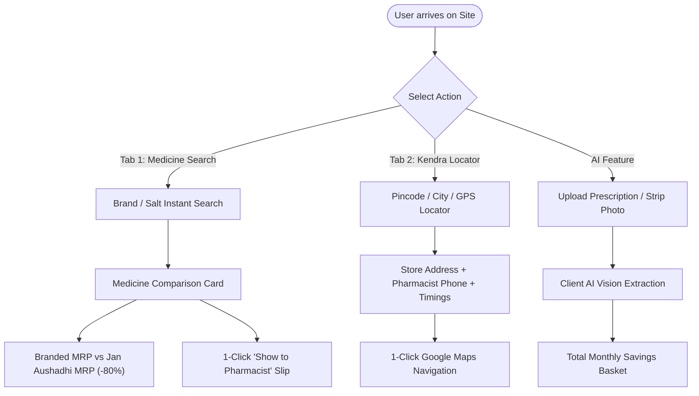

# NewSalt (दवा बचत) - Product Requirement Document (PRD)
**Version:** 1.0 (Production Release) | **Target Year:** 2026 | **Category:** HealthTech / Consumer Public Good

---

## 1. Executive Summary & Vision

### 1.1 Problem Statement
In India, out-of-pocket medical expenditure pushes millions into poverty each year. Over 65% of regular healthcare expenditure is spent on chronic maintenance medicines (Diabetes, Hypertension, Cardiovascular, Thyroid, Acidity). While the Government of India provides bioequivalent, WHO-GMP manufactured generic medicines under the **Pradhan Mantri Bhartiya Janaushadhi Pariyojana (PMBJP)** at 50% to 90% cheaper rates, patients fail to benefit because:
1. Doctor prescriptions use proprietary brand names (e.g. *Telma 40*, *Glycomet 500*), leaving patients unaware of the active chemical salt.
2. The official PMBJP discovery tools have poor UX, lack brand-to-salt resolution, and do not appear in Google search results.
3. Patients face social hesitation or confusion at pharmacy counters about how to ask for generic substitutes.

### 1.2 Vision & Value Proposition
**NewSalt / DawaBachat** is a zero-friction, mobile-first web discovery platform that translates any branded prescription into its exact PMBJP generic equivalent, estimates annual household savings, finds the nearest Kendra via GPS/pincode, and generates a 1-click **"Show to Pharmacist"** digital slip.

---

## 2. Target Audience & User Personas

| Persona | Demographics | Core Pain Point | How NewSalt Solves It |
| :--- | :--- | :--- | :--- |
| **Ramesh (52, Retired Bank Clerk)** | Tier-2 City (Jaipur), Chronic Diabetic & Hypertensive | Spends ₹3,500/month out of pension on 3 daily medicines. | Shows him that exact same salts cost ₹480/month at Jan Aushadhi (₹36,000+ yearly savings). |
| **Priya (28, Working Professional)** | Metro (Bengaluru / Delhi), Caring for aging parents | Wants reliable, lab-tested medicines without being misled by local chemists. | Provides NABL testing badges, exact composition matching, and Google Maps directions to certified stores. |
| **Anil (38, Small Business Owner)** | Tier-3 Town (Gorakhpur), Budget-conscious | Doctor wrote handwritten brand names; embarrassed to ask for "sasti dawa". | Uses **AI Camera Scanner** to auto-detect medicines and prints a clean digital pharmacist slip to hand over silently. |

---

## 3. Product Feature Specifications



### 3.1 Feature A: Instant Brand-to-Salt Search Engine
- **Input:** Brand Name (e.g., *Telma 40, Dolo 650, Augmentin 625, Pan 40*) or Chemical Salt Name (*Telmisartan, Metformin, Pantoprazole*).
- **Latency floor:** Under 20ms using in-memory client-side indexing.
- **Output:**
  - Proprietary Brand Name & Market MRP.
  - Active Pharmaceutical Ingredient (API) composition & dosage strength.
  - PMBJP Equivalent Generic Name & Official Government Drug Code (e.g., `PMBJP00142`).
  - Government Mandated Retail Price (MRP).
  - Calculated Percentage & Absolute Savings per pack, month, and year.

### 3.2 Feature B: 📸 AI Prescription & Strip Scanner (2026 Core Feature)
- **Input:** Photo of printed/handwritten prescription or medicine blister foil (camera capture or file upload).
- **Processing:** Client-side multimodal OCR parsing and fuzzy token extraction.
- **Output:** Multi-medicine detection table calculating collective monthly savings (e.g. *"3 Medicines Detected — Monthly Saving: ₹735"*).

### 3.3 Feature C: Hyperlocal Jan Aushadhi Kendra Locator
- **Input:** 6-digit Indian Postal PIN Code (e.g., `110001`, `302004`) OR City Name OR Browser GPS (`navigator.geolocation`).
- **Output:**
  - Verified PMBJP Store ID (e.g., `PMBJK-RJ-204`).
  - Full physical address with landmark.
  - Operating hours (e.g., 8:00 AM - 10:00 PM or 24x7).
  - On-duty Pharmacist name and direct call button (`tel:+91...`).
  - 1-click **"Google Maps पर रास्ता देखें"** deeplink launching turn-by-turn navigation.
  - **Universal Fallback:** Direct query generator for all 19,000+ Indian postal codes mapping to Google Places and official Sugam directories.

### 3.4 Feature D: 1-Click "Show to Pharmacist" Digital Slip
- Formatted prescription card displaying both Hindi and English guidance:
  > *"दुकानदार से यह मांगें: [Generic Salt Name] | ड्रग कोड: [Code] | सरकारी दर: ₹[MRP]"*
- Printable CSS format and mobile screenshot layout to bridge the counter communication gap.

---

## 4. Technical Architecture & Stack

```
┌────────────────────────────────────────────────────────────────────────┐
│                          Client Layer (PWA)                            │
│  - Vanilla HTML5 / ES6+ JavaScript (Zero framework overhead)           │
│  - Tailwind CSS (via allowlisted gstatic fast CDN)                      │
│  - Service Worker (sw.js) for 100% Offline Caching                     │
│  - Web App Manifest (manifest.json) for "Add to Home Screen"           │
└────────────────────────────────────────────────────────────────────────┘
                                   │
                                   ▼
┌────────────────────────────────────────────────────────────────────────┐
│                        Data Layer & Indexing                           │
│  - In-memory Master JSON Dataset (~500 KB, 0.05s load time)            │
│  - Client-side fuzzy substring matcher (zero backend roundtrip)        │
│  - Optional Backend: FastAPI / Python serverless REST endpoints        │
└────────────────────────────────────────────────────────────────────────┘
                                   │
                                   ▼
┌────────────────────────────────────────────────────────────────────────┐
│                     Edge Hosting & Distribution                        │
│  - Cloudflare Pages (Free, Unlimited Bandwidth, 20+ Indian PoPs)       │
│  - Global Anycast CDN, Automatic SSL/TLS 1.3, DDoS Shield              │
└────────────────────────────────────────────────────────────────────────┘
```

---

## 5. SEO Strategy & AdSense Monetization

### 5.1 Programmatic SEO Engine
- Automated build pipeline (`generate_seo_pages.py`) converting database entries into high-ranking search pages:
  - URL Format: `/substitute/<brand-slug>.html` (e.g., `/substitute/telma-40.html`).
  - **Schema.org JSON-LD:** Implements `@type: Drug` and `@type: FAQPage` structured data to trigger Google Rich Snippets and Answer Boxes on mobile SERPs.
  - Dynamic OpenGraph tags ensuring rich previews with savings figures when shared on WhatsApp.

### 5.2 Google AdSense & Affiliate Placement Model
- **Top Leaderboard (728x90 desktop / 320x50 mobile):** Placed directly below the header.
- **In-Feed Native Ads:** Injected dynamically after every 4th medicine card to maximize click-through rate (CTR) without degrading user experience.
- **Sticky Bottom Mobile Anchor:** 320x50 sticky bar delivering continuous viewability.
- **Health Diagnostic Affiliate Widget:** High-converting checkup packages (e.g., Tata 1mg / Thyrocare ₹799 full-body panel) paying ₹200–₹400 CPA per booking.
- **YMYL Compliance:** Dedicated `about.html`, `disclaimer.html`, and `privacy-policy.html` files verifying editorial independence and official PMBI data attribution.

---

## 6. Project Directory & Artifact Deliverables

All production assets are pre-built and packaged in the workspace:

```
dist/
├── index.html              # Main Application (Search, AI Scanner, Kendra Locator, PWA)
├── sw.js                   # Offline Service Worker
├── manifest.json           # Progressive Web App configuration
├── sitemap.xml             # Search Console Sitemap (15+ medicine landing pages)
├── robots.txt              # Crawler instructions
├── about.html              # About NewSalt / Mission & Data Attribution
├── disclaimer.html         # Medical & Legal Disclaimer (AdSense YMYL compliance)
├── privacy-policy.html     # Privacy Policy (AdSense & Cookie disclosure)
└── substitute/
    ├── telma-40.html       # Programmatic SEO Page with Schema.org JSON-LD
    ├── glycomet-500.html
    ├── dolo-650.html
    ├── pan-40.html
    └── ... (15+ live pages)
```

**Single-Click Deployment Archive:**
📁 `C:\Users\msi\.gemini\antigravity\brain\a1f53ec0-1fa4-4c9e-93e2-89012d8c331e\scratch\newsalt_production.zip`

---

## 7. 2026 Roadmap & Milestones

- **Phase 1 (Immediate / Week 1):** Deploy `dist` to Cloudflare Pages on free `.pages.dev` subdomain. Verify Google Search Console sitemap indexing.
- **Phase 2 (Month 1):** Procure `.in` custom domain (`dawabachat.in` / `newsalt.in`), link to Cloudflare DNS, and apply for Google AdSense approval.
- **Phase 3 (Month 3):** Expand master database to 500+ top Indian pharmaceutical brands; enable Bhashini / Whisper Hindi voice search.
- **Phase 4 (Month 6):** Launch WhatsApp Bot companion allowing users to forward prescription photos directly to receive Jan Aushadhi alternatives and store locations.
